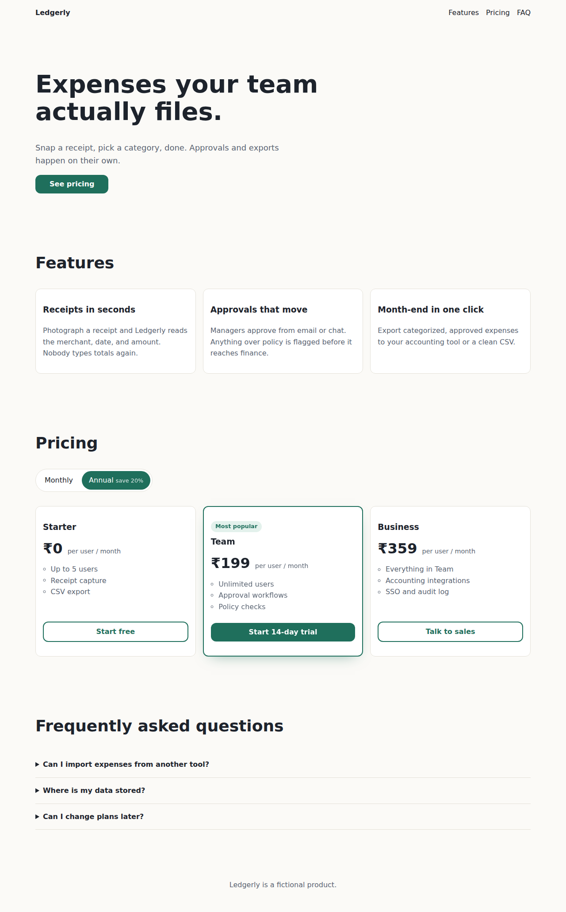

# Ledgerly — marketing site

The public website for Ledgerly, a (fictional) expense-tracking product for small teams.
Hand-written HTML and CSS with no framework or build step: fast, accessible, and easy to host anywhere.

Dark mode: [screenshot](docs/screenshot-dark.png)

## Highlights
- Semantic landmarks, skip link, and a heading outline that screen readers can navigate
- A token-based design system in CSS custom properties; dark mode overrides tokens only
- Fluid typography with `clamp()`, intrinsic layouts with Grid `auto-fit` / `minmax`
- Zero JavaScript for core interactions (pricing toggle, FAQ) — progressive enhancement only

## Run
Open `index.html`, or `npx serve .`

## Quality bar
Lighthouse 95+ on every category, axe DevTools clean, fully usable by keyboard. Results are recorded in
`docs/audit.md` for each release.
